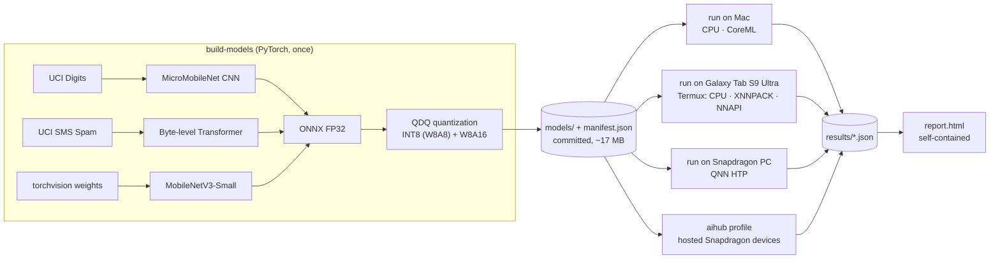

# edge-ai-bench

[](https://github.com/RobiiAragon/edge-ai-bench/actions/workflows/ci.yml)


[English](README.md) · **Español**

**Mide los mismos modelos ONNX en CPU, Apple CoreML, Qualcomm QNN (NPU Hexagon), NNAPI,
XNNPACK y CUDA. Calcula cuánta exactitud cuesta la cuantización INT8 y cuánta latencia
ahorra, y junta los resultados de varios dispositivos en un solo reporte HTML.**

Antes de desplegar un modelo en un dispositivo hay que contestar tres preguntas: *¿qué tan
rápido corre en este chip, qué parte del grafo ejecuta de verdad el acelerador y cuánta
exactitud se pierde al cuantizar?* edge-ai-bench las contesta con un comando por
dispositivo.

- **Latencia** p50 / p90 / p99 (batch 1, shapes estáticos), **throughput** (batch 16),
  **tiempo de carga**, **memoria pico**, **tamaño del modelo**.
- **Cobertura del EP**: cuántos nodos y particiones toma cada execution provider, según el
  log de capacidades del propio ONNX Runtime. Con este dato se entiende por qué una corrida
  "acelerada" puede ser más lenta que la CPU.
- **Cuantización**: variantes estáticas **INT8 QDQ** (W8A8) y **W8A16** generadas con la
  configuración de ONNX Runtime para QNN (`get_qnn_qdq_config`), que es el formato que consume
  el backend HTP de Qualcomm. La exactitud se compara contra FP32 en un set de prueba aparte.
- **Reporte multi-dispositivo**: un HTML autocontenido (sin JS ni CDN) que junta los
  resultados de tu laptop, de una tablet Android con Termux y de dispositivos en la nube de
  Qualcomm AI Hub.
- **Qualcomm AI Hub (opcional)**: compila y perfila en teléfonos Snapdragon hospedados con
  `qai-hub` si tienes un token. Si no lo tienes, el comando te explica cómo configurarlo.
- Los EPs que no estén instalados se **saltan con un mensaje claro**, sin tronar.

## Cómo funciona



Cada combinación (modelo, variante, EP) corre en un **subproceso nuevo**. Así las
mediciones de memoria no arrastran nada de corridas anteriores y un EP que truene no tumba
toda la suite.

## Inicio rápido

```bash
git clone https://github.com/RobiiAragon/edge-ai-bench && cd edge-ai-bench
python3.12 -m venv .venv && source .venv/bin/activate
pip install -e ".[dev]"

edge-ai-bench providers          # qué EPs expone tu build de onnxruntime
edge-ai-bench run                # todos los modelos x {fp32,int8,w8a16} x EPs disponibles
edge-ai-bench report results/*.json -o report.html
```

Los modelos ONNX y los sets de evaluación vienen en el repo (~17 MB), así que `run` no
necesita PyTorch ni descargas. Para regenerarlos desde cero (≈1 minuto en un M5 Max):

```bash
pip install -e ".[train]"
edge-ai-bench build-models
```

| Comando | Para qué |
|---|---|
| `providers` | EPs disponibles / saltados y la razón |
| `info` | Descripción del dispositivo (CPU/SoC, SO, RAM, versión de ORT), sin hostname ni seriales |
| `build-models` | Entrena, exporta y cuantiza los modelos incluidos (extra `[train]`) |
| `quantize` | Cuantiza a QDQ cualquier modelo ONNX (`--scheme qnn\|generic`) |
| `run` | Benchmark (`--providers cpu,coreml,qnn,cuda,nnapi,xnnpack`, `--variants`, `--iters`) |
| `report` | Junta archivos JSON de resultados en un reporte HTML |
| `aihub setup\|devices\|profile` | Perfilado en dispositivos hospedados de Qualcomm AI Hub |

## Modelos y datos

| Modelo | Tarea | Datos (licencia) | Tamaño FP32 |
|---|---|---|---|
| `digits-cnn` | clasificación de imágenes, 10 clases, 1×32×32 | UCI Optical Recognition of Handwritten Digits vía scikit-learn (CC BY 4.0) | 287 KB |
| `sms-transformer` | spam/ham, transformer de 2 capas a nivel byte (d=96, 128 bytes) | UCI SMS Spam Collection (CC BY 4.0) | 751 KB |
| `mobilenetv3-small` | backbone ImageNet 3×224×224 (**solo latencia/tamaño**) | pesos de torchvision (BSD-3-Clause) | 9.9 MB |

## Resultados medidos en mi Mac

**Hardware:** MacBook Pro (Mac17,6), Apple **M5 Max**, 48 GB RAM, macOS 27.2, conectada a
corriente. **Software:** Python 3.12.16, onnxruntime 1.32.0 (EPs CPU + CoreML;
`MLProgram`, `MLComputeUnits=ALL`). **Parámetros:** 20 iteraciones de calentamiento y 200
medidas con batch 1, ventana de throughput de 3 s con batch 16, shapes estáticos. Datos
crudos: [`results/mac-apple-m5-max.json`](results/mac-apple-m5-max.json). **Reporte en vivo:**
[robiiaragon.github.io/edge-ai-bench/report.html](https://robiiaragon.github.io/edge-ai-bench/report.html).

| Modelo | Variante | EP | p50 (ms) | p90 (ms) | p99 (ms) | Throughput (muestras/s, b=16) | Cobertura EP | RSS pico (MB) | Tamaño (KB) | Exactitud |
|---|---|---|---:|---:|---:|---:|---|---:|---:|---:|
| digits-cnn | FP32 | cpu | 0.110 | 0.122 | 0.134 | 39,781 | todo (CPU) | 75 | 287 | 97.49% |
| digits-cnn | FP32 | coreml | 0.101 | 0.105 | 0.142 | 42,622 | 24/24 nodos, 1 part. | 94 | 287 | 97.49% |
| digits-cnn | INT8 | cpu | 0.078 | 0.081 | 0.087 | 19,842 | todo (CPU) | 69 | 96 | 97.77% |
| digits-cnn | INT8 | coreml | 0.084 | 0.087 | 0.117 | 18,671 | 1/65 nodos, 1 part. | 83 | 96 | 97.77% |
| digits-cnn | W8A16 | cpu | 0.158 | 0.175 | 0.220 | 23,812 | todo (CPU) | 72 | 96 | 97.49% |
| digits-cnn | W8A16 | coreml | 0.172 | 0.192 | 0.199 | 22,858 | 1/65 nodos, 1 part. | 89 | 96 | 97.49% |
| sms-transformer | FP32 | cpu | 0.291 | 0.304 | 0.348 | 8,335 | todo (CPU) | 104 | 751 | 97.40% |
| sms-transformer | FP32 | coreml | 0.227 | 0.238 | 0.270 | 31,528 | 87/88 nodos, 1 part. | 112 | 751 | 97.40% |
| sms-transformer | INT8 | cpu | 0.436 | 0.510 | 0.532 | 4,514 | todo (CPU) | 107 | 263 | 94.34% |
| sms-transformer | INT8 | coreml | 1.857 | 2.236 | 2.588 | 1,621 | 59/308 nodos, 45 part. | 212 | 263 | 94.34% |
| sms-transformer | W8A16 | cpu | 0.697 | 0.781 | 0.819 | 3,461 | todo (CPU) | 115 | 300 | 97.40% |
| sms-transformer | W8A16 | coreml | 1.856 | 2.145 | 2.387 | 1,603 | 59/308 nodos, 45 part. | 215 | 300 | 97.40% |
| mobilenetv3-small | FP32 | cpu | 1.059 | 1.123 | 1.152 | 1,958 | todo (CPU) | 189 | 9,942 | n/a |
| mobilenetv3-small | FP32 | coreml | 2.993 | 3.030 | 3.061 | 628 | 38/60 nodos, 19 part. | 440 | 9,942 | n/a |
| mobilenetv3-small | INT8 | cpu | 0.747 | 0.894 | 0.920 | 2,053 | todo (CPU) | 137 | 2,699 | n/a |
| mobilenetv3-small | INT8 | coreml | 4.906 | 5.015 | 5.432 | 352 | 72/525 nodos, 72 part. | 554 | 2,699 | n/a |
| mobilenetv3-small | W8A16 | cpu | 2.075 | 2.211 | 2.289 | 1,050 | todo (CPU) | 201 | 2,704 | n/a |
| mobilenetv3-small | W8A16 | coreml | 5.751 | 6.213 | 6.740 | 388 | 72/525 nodos, 72 part. | 564 | 2,704 | n/a |


El RSS pico es de todo el proceso, así que incluye ~60 MB de base de Python, NumPy y ORT.

### Lo que dicen los números

1. **La cobertura del EP decide si el acelerador sirve.** Cuando CoreML toma todo el grafo
   (transformer: 87/88 nodos en 1 partición), el throughput con batch 16 es **3.8× el de la
   CPU** (31.5k vs 8.3k muestras/s). Cuando el grafo se fragmenta (MobileNetV3: 19
   particiones por las ops hard-swish/SE), cada ida y vuelta CPU↔CoreML cuesta tiempo y
   CoreML termina **2.8× más lento** que la CPU.
2. **INT8 QDQ es un formato para la NPU de Qualcomm, no para CoreML.** El EP de CoreML casi
   no toma nodos de un grafo QDQ (1/65 en la CNN), así que los modelos cuantizados terminan
   corriendo en CPU con hand-offs extra. En QNN HTP esos mismos nodos QDQ se fusionan en
   kernels enteros nativos. Para medir eso están `aihub profile` y la corrida en Snapdragon.
3. **Las activaciones de 8 bits afectan al transformer y las de 16 bits no.** W8A8 pierde
   **3.06 pp** (97.40% → 94.34%), mientras que **W8A16 recupera exactamente la exactitud
   FP32** (97.40%) con un modelo 2.5× más chico. W8A16 es la receta habitual en HTP para modelos
   con atención. La CNN no pierde nada en INT8 (gana 0.28 pp, que con 359 imágenes de prueba
   es ruido).
4. **En CPU, INT8 mejora más la latencia que el throughput:** el p50 mejora 1.4× en ambas
   CNNs con batch 1, pero en la CNN chica el throughput con batch 16 cae a la mitad. Los
   kernels int8 depthwise de ORT en CPU escalan peor por batch que los GEMM FP32.

## Correrlo en otros dispositivos

**Galaxy Tab S9 Ultra (Snapdragon 8 Gen 2) con Termux.** Instala Termux desde F-Droid y:

```bash
pkg install -y git
git clone https://github.com/RobiiAragon/edge-ai-bench && cd edge-ai-bench
bash scripts/android_termux_check.sh            # CPU, XNNPACK, NNAPI; ~5 min
```

El script instala el `python-onnxruntime` precompilado de Termux (no hay wheels de pip
para Android), corre con `cpu,xnnpack,nnapi` y escribe `results/android-<modelo>.json`.
Copia ese archivo a la Mac y ejecuta `edge-ai-bench report results/*.json`. Deja la tablet
conectada y con la pantalla encendida, porque el throttling térmico se nota en el p99.

**Qualcomm AI Hub (dispositivos Snapdragon hospedados).**

```bash
pip install -e ".[aihub]"
qai-hub configure --api_token <TOKEN>           # token en https://aihub.qualcomm.com/
edge-ai-bench aihub devices --filter 8gen2
edge-ai-bench aihub profile --device "Samsung Galaxy S23 (Family)" --runtime qnn_dlc
```

Compila con `submit_compile_job(..., options="--target_runtime qnn_dlc")`, perfila con
`submit_profile_job` y guarda los tiempos medidos en el dispositivo con el mismo esquema
JSON, así que salen en el mismo reporte. Sin token, `edge-ai-bench aihub` muestra estos
pasos en vez de fallar. Todavía no lo he corrido contra el servicio real porque no hay token
en esta máquina. La integración tiene pruebas unitarias contra la API verificada de `qai-hub` 0.58.

## Desarrollo

```bash
pip install -e ".[dev]"
ruff check . && ruff format --check . && pytest -q
scripts/mac_check.sh --full
```

El CI corre lint, pruebas y un benchmark corto en `ubuntu-latest` y `macos-latest`
(Python 3.11 y 3.12), y sube el reporte HTML como artifact.

## Roadmap

- [ ] Resultados de la Galaxy Tab S9 Ultra (Termux: CPU / XNNPACK / NNAPI) en el reporte
- [ ] Resultados de Qualcomm AI Hub para Snapdragon 8 Gen 2 / 8 Elite (QNN HTP, INT8 vs W8A16)
- [ ] Corrida nativa del EP QNN en una laptop Windows on Snapdragon (`onnxruntime-qnn`)
- [ ] Exactitud de MobileNetV3 en un subconjunto de ImageNet (Imagenette)
- [ ] Precisión mixta: solo las capas sensibles (softmax/LayerNorm) en 16 bits
- [ ] Energía por inferencia (powermetrics en macOS, battery stats en Android)

## Licencia

MIT © Jesús Aragón. Las licencias de datos y pesos están en [Modelos y datos](#modelos-y-datos).
