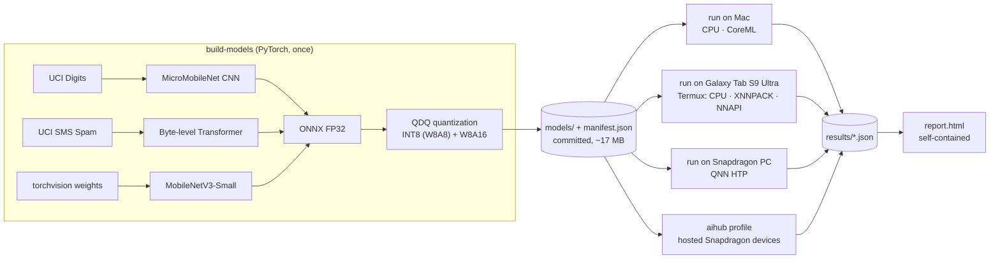

# edge-ai-bench

[](https://github.com/RobiiAragon/edge-ai-bench/actions/workflows/ci.yml)


**English** · [Español](README.es.md)

**Benchmark the same ONNX models on CPU, Apple CoreML, Qualcomm QNN (Hexagon NPU), NNAPI,
XNNPACK and CUDA. Measure what INT8 quantization costs in accuracy and what it gains in
latency, and merge the results from several devices into one HTML report.**

Deploying a model on-device starts with three questions: *how fast is it on this chip, how
much of the graph does the accelerator actually run, and how much accuracy does
quantization cost?* edge-ai-bench answers all three with one command per device.

- **Latency** p50 / p90 / p99 (batch 1, static shapes), **throughput** (batch 16),
  **load time**, **peak memory**, **model size**.
- **EP coverage**: how many nodes and partitions each execution provider actually takes,
  parsed from ONNX Runtime's own capability log. This is the number that explains why an
  "accelerated" run can be slower than the CPU.
- **Quantization**: static **INT8 QDQ** (W8A8) and **W8A16** variants made with ONNX
  Runtime's QNN-targeted config (`get_qnn_qdq_config`), which is the format Qualcomm's HTP
  backend consumes. Accuracy is measured against FP32 on a held-out set.
- **Multi-device report**: one self-contained HTML file (no JS, no CDN) that merges results
  from your laptop, an Android tablet through Termux, and Qualcomm AI Hub cloud devices.
- **Qualcomm AI Hub (optional)**: compile and profile on hosted Snapdragon phones with
  `qai-hub` when you have an API token. Without one, the command prints how to set it up.
- Missing EPs are **skipped with a clear reason**, never a crash.

## How it works



Each (model, variant, EP) runs in a **fresh subprocess**, so memory numbers aren't polluted
by earlier runs and a crashing EP can't take down the whole suite.

## Quickstart

```bash
git clone https://github.com/RobiiAragon/edge-ai-bench && cd edge-ai-bench
python3.12 -m venv .venv && source .venv/bin/activate
pip install -e ".[dev]"

edge-ai-bench providers          # which EPs this onnxruntime build exposes
edge-ai-bench run                # all models x {fp32,int8,w8a16} x available EPs
edge-ai-bench report results/*.json -o report.html
```

The ONNX models and eval sets are committed (~17 MB), so `run` needs neither PyTorch nor a
download. To rebuild them from scratch, which takes about 1 minute on an M5 Max:

```bash
pip install -e ".[train]"
edge-ai-bench build-models       # trains, exports, quantizes, writes models/manifest.json
```

Quantize your own model:

```bash
edge-ai-bench quantize my.onnx --calib calib.npz --input-name input --out my.int8.onnx
edge-ai-bench quantize my.onnx --calib calib.npz --input-name input --out my.w8a16.onnx \
    --activation-bits 16            # W8A16: uint16 activations
```

| Command | Purpose |
|---|---|
| `providers` | List usable / skipped execution providers and why |
| `info` | Device description (CPU/SoC, OS, RAM, ORT version), with no hostnames or serials |
| `build-models` | Train, export and quantize the bundled models (`[train]` extra) |
| `quantize` | QDQ-quantize any ONNX model (`--scheme qnn\|generic`, `--activation-bits 8\|16` for W8A8 or W8A16) |
| `run` | Benchmark (`--providers cpu,coreml,qnn,cuda,nnapi,xnnpack`, `--variants`, `--iters`, `--batch`) |
| `report` | Merge result JSON files into one HTML report |
| `table` | Print result JSON files as a Markdown table (`--baseline cpu` adds a p50 speed-up column, `-o` writes a file) |
| `aihub setup\|devices\|profile` | Qualcomm AI Hub hosted-device profiling |

### Hardware-specific installs

| Platform | Install | EPs |
|---|---|---|
| macOS Apple Silicon | `pip install -e ".[dev]"` | CPU, CoreML |
| Windows on Snapdragon (X Elite etc.) | `pip install -e ".[qnn,dev]"` | CPU, **QNN (HTP NPU)** |
| Android (Termux) | `bash scripts/android_termux_check.sh` | CPU, XNNPACK, NNAPI |
| NVIDIA GPU | `pip install -e ".[gpu,dev]"` | CPU, CUDA |

## Models and data

| Model | Task | Data (license) | Params / FP32 size |
|---|---|---|---|
| `digits-cnn` | 10-class image classification, 1×32×32 | UCI Optical Recognition of Handwritten Digits, via scikit-learn (CC BY 4.0) | 287 KB |
| `sms-transformer` | spam/ham text classification, 2-layer byte-level transformer (d=96, 128 bytes) | UCI SMS Spam Collection (CC BY 4.0) | 751 KB |
| `mobilenetv3-small` | ImageNet backbone, 3×224×224 (**latency/size only**, no ImageNet data shipped) | torchvision weights (BSD-3-Clause) | 9.9 MB |

The splits are stratified 80/20 with a fixed seed. Calibration uses 256 training samples, so
the test set never touches quantization.

## Results: measured on my Mac

**Hardware:** MacBook Pro (Mac17,6), Apple **M5 Max**, 48 GB RAM, macOS 27.2, on AC power.
**Software:** Python 3.12.16, onnxruntime 1.32.0 (CPU + CoreML EPs; CoreML options
`MLProgram`, `MLComputeUnits=ALL`). **Settings:** 20 warm-up and 200 timed iterations at
batch 1, 3 s throughput window at batch 16, static shapes. Raw data:
[`results/mac-apple-m5-max.json`](results/mac-apple-m5-max.json). **Live report:**
[robiiaragon.github.io/edge-ai-bench/report.html](https://robiiaragon.github.io/edge-ai-bench/report.html).

| Model | Variant | EP | p50 (ms) | p90 (ms) | p99 (ms) | Throughput (samples/s, b=16) | EP coverage | Peak RSS (MB) | Size (KB) | Accuracy |
|---|---|---|---:|---:|---:|---:|---|---:|---:|---:|
| digits-cnn | FP32 | cpu | 0.110 | 0.122 | 0.134 | 39,781 | all (CPU) | 75 | 287 | 97.49% |
| digits-cnn | FP32 | coreml | 0.101 | 0.105 | 0.142 | 42,622 | 24/24 nodes, 1 part. | 94 | 287 | 97.49% |
| digits-cnn | INT8 | cpu | 0.078 | 0.081 | 0.087 | 19,842 | all (CPU) | 69 | 96 | 97.77% |
| digits-cnn | INT8 | coreml | 0.084 | 0.087 | 0.117 | 18,671 | 1/65 nodes, 1 part. | 83 | 96 | 97.77% |
| digits-cnn | W8A16 | cpu | 0.158 | 0.175 | 0.220 | 23,812 | all (CPU) | 72 | 96 | 97.49% |
| digits-cnn | W8A16 | coreml | 0.172 | 0.192 | 0.199 | 22,858 | 1/65 nodes, 1 part. | 89 | 96 | 97.49% |
| sms-transformer | FP32 | cpu | 0.291 | 0.304 | 0.348 | 8,335 | all (CPU) | 104 | 751 | 97.40% |
| sms-transformer | FP32 | coreml | 0.227 | 0.238 | 0.270 | 31,528 | 87/88 nodes, 1 part. | 112 | 751 | 97.40% |
| sms-transformer | INT8 | cpu | 0.436 | 0.510 | 0.532 | 4,514 | all (CPU) | 107 | 263 | 94.34% |
| sms-transformer | INT8 | coreml | 1.857 | 2.236 | 2.588 | 1,621 | 59/308 nodes, 45 part. | 212 | 263 | 94.34% |
| sms-transformer | W8A16 | cpu | 0.697 | 0.781 | 0.819 | 3,461 | all (CPU) | 115 | 300 | 97.40% |
| sms-transformer | W8A16 | coreml | 1.856 | 2.145 | 2.387 | 1,603 | 59/308 nodes, 45 part. | 215 | 300 | 97.40% |
| mobilenetv3-small | FP32 | cpu | 1.059 | 1.123 | 1.152 | 1,958 | all (CPU) | 189 | 9,942 | n/a |
| mobilenetv3-small | FP32 | coreml | 2.993 | 3.030 | 3.061 | 628 | 38/60 nodes, 19 part. | 440 | 9,942 | n/a |
| mobilenetv3-small | INT8 | cpu | 0.747 | 0.894 | 0.920 | 2,053 | all (CPU) | 137 | 2,699 | n/a |
| mobilenetv3-small | INT8 | coreml | 4.906 | 5.015 | 5.432 | 352 | 72/525 nodes, 72 part. | 554 | 2,699 | n/a |
| mobilenetv3-small | W8A16 | cpu | 2.075 | 2.211 | 2.289 | 1,050 | all (CPU) | 201 | 2,704 | n/a |
| mobilenetv3-small | W8A16 | coreml | 5.751 | 6.213 | 6.740 | 388 | 72/525 nodes, 72 part. | 564 | 2,704 | n/a |

Peak RSS is for the whole worker process, so it includes about 60 MB of Python, NumPy and ORT baseline.
This table is generated from the raw JSON, not typed by hand:
`edge-ai-bench table results/mac-apple-m5-max.json` (add `--baseline cpu` for a speed-up column).

### What the numbers say

1. **EP coverage decides whether an accelerator helps.** When CoreML takes the whole graph
   (the transformer: 87/88 nodes in 1 partition), batch-16 throughput is **3.8× the CPU's**
   (31.5k vs 8.3k samples/s). When the graph is fragmented (MobileNetV3: 19 partitions,
   because of the hard-swish/SE ops), every CPU↔CoreML hand-off costs time and CoreML ends up
   **2.8× slower** than the CPU.
2. **QDQ INT8 is a format for the Qualcomm NPU, not for CoreML.** The CoreML EP takes almost
   none of a QDQ graph (1/65 nodes for the CNN), so the quantized models effectively run on
   CPU with extra hand-offs. On QNN HTP, the same QDQ nodes are fused into native integer
   kernels. That's what the `aihub profile` command and a Snapdragon run are for.
3. **8-bit activations hurt the transformer; 16-bit activations don't.** W8A8 drops
   **3.06 pp** of accuracy (97.40% → 94.34%), while **W8A16 recovers FP32 exactly** (97.40%) at
   2.5× smaller size. W8A16 is the usual HTP recipe for attention models. The CNN loses
   nothing at INT8 (it actually gains 0.28 pp, which is within noise for a 359-image test set).
4. **INT8 on CPU helps latency more than throughput:** p50 improves by 1.4× for both CNNs
   at batch 1, but for the tiny CNN, batch-16 throughput halves. ORT's CPU int8 depthwise
   kernels batch poorly, while the FP32 path uses well-tuned GEMMs.

## Run it on other devices

**Galaxy Tab S9 Ultra (Snapdragon 8 Gen 2) via Termux.** Install Termux from F-Droid, then:

```bash
pkg install -y git
git clone https://github.com/RobiiAragon/edge-ai-bench && cd edge-ai-bench
bash scripts/android_termux_check.sh            # CPU, XNNPACK, NNAPI; ~5 min
```

The script installs Termux's prebuilt `python-onnxruntime` (there are no pip wheels for
Android), benchmarks with `cpu,xnnpack,nnapi` and writes `results/android-<model>.json`.
Copy that file back to the Mac and run `edge-ai-bench report results/*.json` for the
side-by-side report. Keep the tablet plugged in with the screen on: thermal throttling
shows up in p99.

**Qualcomm AI Hub (hosted Snapdragon devices).**

```bash
pip install -e ".[aihub]"
qai-hub configure --api_token <TOKEN>           # token from https://aihub.qualcomm.com/
edge-ai-bench aihub devices --filter 8gen2
edge-ai-bench aihub profile --device "Samsung Galaxy S23 (Family)" --runtime qnn_dlc
```

This compiles each model with `submit_compile_job(..., options="--target_runtime qnn_dlc")`,
profiles it with `submit_profile_job`, and stores the on-device inference times (µs →
p50/p90/p99) and peak memory in the same JSON schema, so the cloud devices show up in the same
report. Without a token, `edge-ai-bench aihub` prints these setup steps instead of failing.
I haven't run it against the live service yet: no token on this machine. The integration is
unit-tested against the verified `qai-hub` 0.58 API.

## Development

```bash
pip install -e ".[dev]"
ruff check . && ruff format --check . && pytest -q
scripts/mac_check.sh            # lint + tests + quick benchmark (written to .cache/, not results/)
scripts/mac_check.sh --full     # same with the documented settings; overwrites results/mac-*.json
```

CI runs lint, the test suite and a smoke benchmark on `ubuntu-latest` and `macos-latest`
(Python 3.11, 3.12 and 3.13), uploads the HTML report as an artifact and writes the smoke
results as a Markdown table into the job summary. CI runners are shared VMs, so their numbers
only show that the pipeline works; they are not benchmark results.

```
src/edge_ai_bench/
  providers.py  EP aliases, availability, provider options, static-shape sessions
  coverage.py   parses ORT GetCapability logs -> nodes/partitions on each EP
  bench.py      per-config subprocess worker: latency, throughput, memory, accuracy
  quantize.py   QDQ static quantization (QNN config, W8A8 / W8A16)
  build.py      model definitions, training, ONNX export
  report.py     self-contained multi-device HTML report
  table.py      Markdown table from result JSON (README / PR / model-card tables)
  aihub.py      Qualcomm AI Hub compile + profile
  device.py     privacy-friendly device description (incl. Android getprop)
```

## Roadmap

- [ ] Galaxy Tab S9 Ultra results (Termux: CPU / XNNPACK / NNAPI) in the committed report
- [ ] Qualcomm AI Hub results for Snapdragon 8 Gen 2 / 8 Elite (QNN HTP, INT8 vs W8A16)
- [ ] Native QNN EP run on a Windows-on-Snapdragon laptop (`onnxruntime-qnn`)
- [ ] ImageNet-subset accuracy for MobileNetV3 (Imagenette), so its INT8 loss can be measured
- [ ] Mixed precision: keep only the sensitive layers (attention softmax / LayerNorm) at 16 bit
- [ ] Energy per inference (powermetrics on macOS, battery stats on Android)

## License

MIT © Jesús Aragón. Dataset and weight licenses are listed in [Models and data](#models-and-data).
